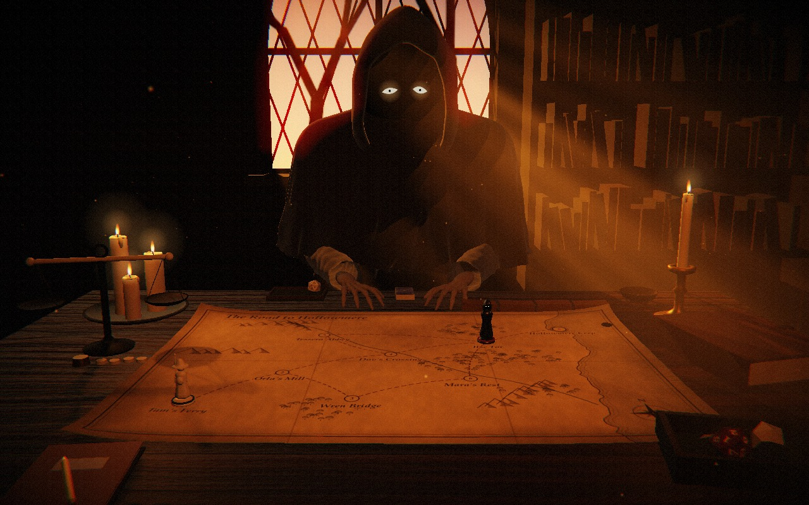
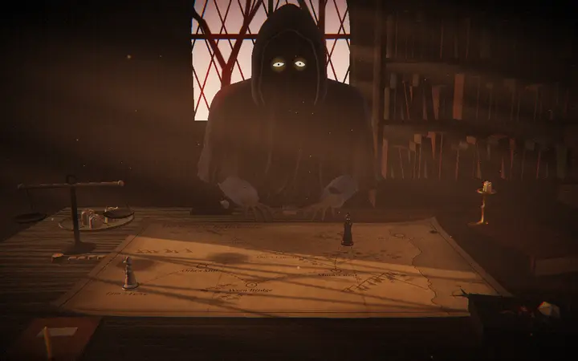
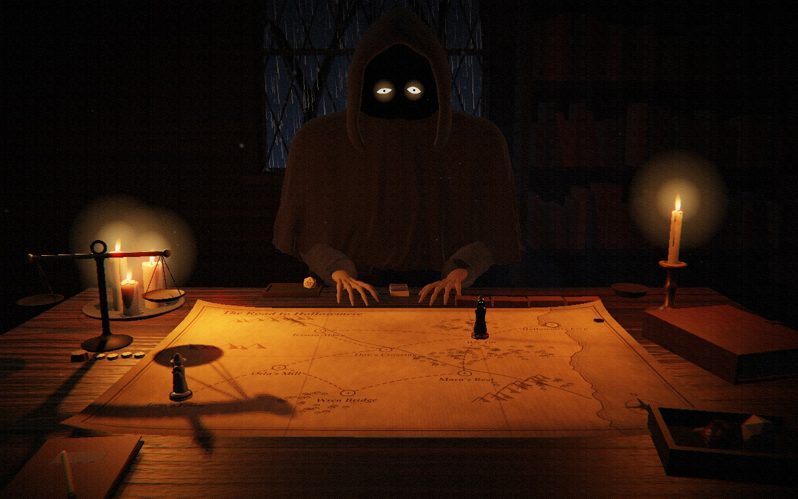
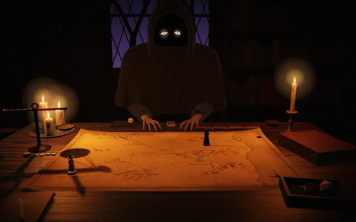
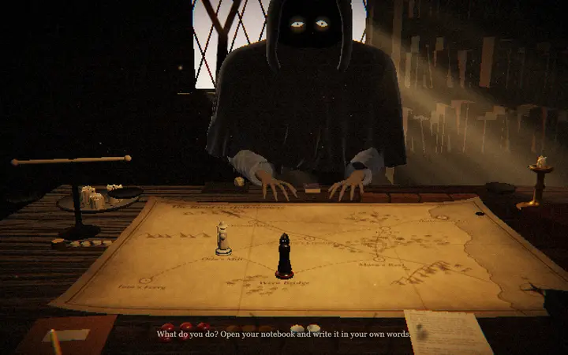
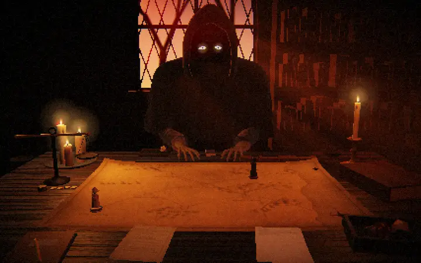
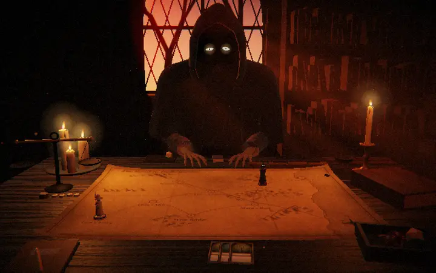
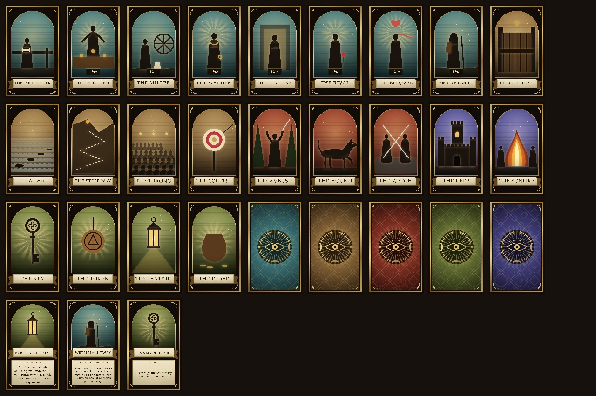
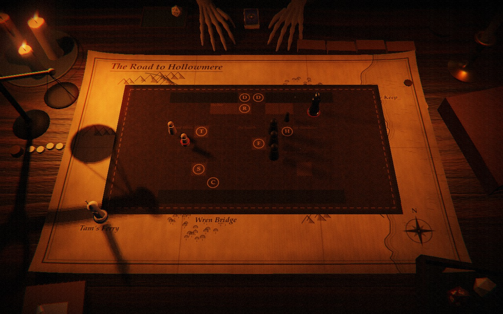

<p align="center">
  
</p>

<h1 align="center">Tallow</h1>

<p align="center">
  <b>A tabletop roleplaying game for <a href="https://github.com/prolix-oc/Lumiverse">Lumiverse</a>, played in one candlelit room.</b><br>
  You sit across a table from a hooded narrator. You write what you do; it weighs it, you throw the die, and it writes what happened and hands the page back.
</p>

<p align="center">
  
  
  
  
  
</p>

<p align="center">
  <a href="#a-look-around">A look around</a> ·
  <a href="#how-a-turn-plays">How a turn plays</a> ·
  <a href="#how-a-fight-works">How a fight works</a> ·
  <a href="#install-it-in-lumiverse">Install</a> ·
  <a href="#run-the-preview">Preview</a> ·
  <a href="docs/DESIGN.md">Design</a>
</p>

---

There is no interface on the screen, only the room. Your character sheet is a stack of papers by your left hand, your history is a pile of pages by your right, your abilities are cards dealt face up in front of you, and the story's road is a map with pieces on it. The narrator is played by your own model, which builds an adventure for the character card you're chatting with. The dice, the rules and every number are code, seeded so a story can be replayed.

The name is a working title.

## A look around

### The room

The hours turn, the weather changes, and the candles burn down through the night. At dusk the narrator sets out new ones and lights them; by morning they're stubs.

<p align="center">
  
</p>

<table>
  <tr>
    <td></td>
    <td></td>
  </tr>
  <tr>
    <td align="center"><sub>Golden hour</sub></td>
    <td align="center"><sub>Night, in the rain</sub></td>
  </tr>
</table>

### The die

Every check is one twenty-sided die. Your hand takes it from the box, you shake it with the pointer and let it go, and you lean in to read it. The face is decided by seeded dice in code before the throw; the throw only shows it.

<p align="center">
  
</p>

### A turn at the table

You write your line in a notebook, tear the page off and hand it over. The narrator says how it read you and loads the balance: its dark weights for how hard the thing is, your pale ones for what you bring. You throw, and it writes what happened under your line and hands the page back.

<p align="center">
  
</p>

### Your pages and your sheets

The pages you've read pile up by your right hand. Pick the pile up and leaf through it: your thumb draws the front page out and tucks it in behind. Who you are, what you can do, who walks with you and what you carry lie in a second, red-ruled stack by your left hand, rewritten as they change.

<p align="center">
  
</p>

### Cards

The road is dealt as cards, face down, and a stop's card is turned when you reach it. Your abilities, companions and the things you carry are dealt face up to your side. Click one to hold it up and read what it does; the arrow keys go to the next.

<p align="center">
  
</p>

<details>
<summary>The whole deck</summary>
<p align="center"></p>
<p>Every card is drawn in code: an arched window over an engraved sky, a gold frame, a ribbon with the card's name, and on a card that does something, what it does. Nothing is copied from any deck.</p>
</details>

### Fights on a battle mat

When a fight starts, the narrator unrolls a leather mat with squares on it. Before your turn, every enemy chalks what it's about to do and which square it will hit.

<p align="center">
  
</p>

## How a turn plays

1. **Something stands in your way.** The narrator says what it is, and the stop's card is turned on the map.
2. **You write what you do,** in your own words. There are no menus. A model reads what your line means; the engine decides what that's worth.
3. **The check is named and weighed.** The narrator names the strength it calls for (Brawn, Grace, Charm, Guile, Wits or Sense) and loads the balance, so you can see how likely it is before you throw. If it read you wrong, write again.
4. **You throw.** d20 + your strength + what helps, against how hard it is. Missing by a little is a partial: it works, at a cost.
5. **The situation changes.** The narrator takes or gives counters (red stones for health, coins for supplies, pale seals for goodwill), writes the turn, and hands the page back. A try that fails is not a dead end: it costs something, closes the way you tried, and makes the ways that are left harder.

A whole story is a road of such stops: forks where you choose a card, companions who join you, things you find, a rival, a clock running down, resting, and abilities to choose when you level up. There are seven kinds of story (a rescue, a heist, a mystery, a journey, a hunt, a romance, a night to survive), 25 stories within them, and a new road laid out by code for each.

## How a fight works

- **Where your abilities come from.** When you make your character you get a **trick**, which always works and needs no die, and a **gift**, which costs 1 grit (you have 2 + your level). Each level-up offers two ability cards and you keep one. In a fight each ability becomes a move: reach, bind, sweep, drain, ward, mend, mark, learn or edge.
- **Your numbers.** Stamina is 4 + 2 × Brawn + level, and it's your health in a fight. Composure is 4 + 2 × Sense + level, and it stands in for Stamina in a battle of charm. Defense is 10 + Grace.
- **A round.** The enemies chalk their next moves on the mat. If you step off a marked square, the blow misses. You write one line, and that line is your whole side's turn: the companions you name do what you say, and the rest act in character. An attack is a d20 + the strength that fits, against the target's Defense. The narrator throws for the enemies, in the open.
- **The end.** The fight ends when one side is down. If you've been down for 3 rounds, you're dragged clear and lose. After 20 rounds, the side with more of its Stamina left wins.

The full rules are in [docs/COMBAT.md](docs/COMBAT.md).

## Where it stands

All four milestones are built. It runs as a local preview page, and as a Lumiverse (Spindle) extension.

1. **The room**: the hours of the day, six kinds of weather, candles that burn down through the night, the narrator, the map and its pieces, and the die.
2. **One moment of the game**: something stands in your way, you write what you do, the game names the check, you throw the die, and the situation changes.
3. **A whole adventure** in trope mode, a rescue or a courtship: the road dealt face down as cards, a stop's card turned when you arrive, forks, companions, things won, resting, a rival, a clock, and abilities to choose at a level-up (docs/SYSTEMS.md). Four wooden blocks at the far edge of the table show which ways past a place are still open; questions to the narrator are answered from the scene without a die; the weather outside the window follows the road.
4. **Inside Lumiverse, for a real card**: "Sit at the table", in Tallow's drawer tab or the Extras menu (the ⋯ button) under the chat's message box, opens the room over the app. The narrator greets you by the card's character, asks which story and who you are, and builds the adventure for the card with your own model while you write. A card set in our own times gets a city road instead of the river road. Leave the table in the middle of a story and it is kept: sit down again and the narrator asks whether to go on.
5. **Many stories, one hero**: seven kinds of story (a rescue, a heist, a mystery, a journey, a hunt, a romance, a night to survive), 25 stories within them, and a new road laid out by code for each, so no two are alike. When a story ends, the narrator says what became of everyone, a story won gives an ability and up to two things to keep, the cards are gathered back into the deck, and the narrator asks for another story, or says goodnight. The hero is kept per chat and card, and the stories already played are not drawn again soon.

Not done yet: nothing from a sitting is written into the chat, and it has not been played inside Lumiverse with a real model (the live tests answered as the model by hand). See [docs/DESIGN.md](docs/DESIGN.md), section 11.

## Install it in Lumiverse

```
bun install
bun run build
```

writes `dist/frontend.js` and `dist/backend.js` (the room's models are inside the frontend file). Then

```
bun scripts/deploy-local.ts D:/Lumiverse
```

copies the build into your Lumiverse's `data/extensions/tallow/`. In Lumiverse, open the drawer, then **Extensions**, and use **Import local extensions** (the owner can), then turn Tallow on. Tallow asks for three permissions, each shown in Lumiverse's own dialog when you first sit down:

- **characters**, to read the chat's character card;
- **generation**, to ask your model to build the adventure and tell what happens;
- **app_manipulation**, to open the room over the whole app (without it, the room opens in a floating window).

Then, once, three optional ones; the game is whole without them:

- **decisions**, so your Decision model reads each line you write in about a second, and reads your written choices (which story, rest or press on, which card);
- **world_books**, so a few entries of the card's lorebook go into the adventure;
- **embeddings**, so your embedding model picks the lorebook entries nearest the card.

**Setting it up**: Tallow has its own tab in Lumiverse's drawer, "Tallow". It has a button to sit at the table and the models: which of your connections each job uses (**Building** the story and who you are, **Narrating** what happens, **Reading your lines** when the Decision model can't) and whether it thinks first, plus your Decision and embedding connections. Anything left on "Auto" uses your default connection; building thinks first when its model can, and the rest answer straight away, so they are quick. Choices are kept in Tallow's user storage (`models.json`). Permissions are asked by Lumiverse's own dialog when you sit down. The tab is outside the game: inside the room there is still nothing but the room.

Open a chat with a character, then press "Sit at the table" in the Tallow tab, or in the ⋯ (Extras) menu under the message box. A card that is a world or a scenario rather than one person is told apart: the story is set there, and your companion is someone of that world. The ✕ at the top leaves the table. Without the generation permission, or if the model does not answer, the game still plays: a made-up adventure with the card's character in it, and plain stand-in lines.

### The book beside an ordinary chat

You do not have to sit at the table. If you would rather write freeform, Tallow can keep the narrator's book beside any chat and leave the chat alone: nothing is read as a move, nothing is refused, and nothing is ever put into the chat. Open the **Book** tab in the drawer (or "The narrator's book" in the ⋯ menu under the message box):

- **Write a chapter now** writes one from everything since the last chapter; say what it should be about if you like.
- **Write by itself** has the narrator write one each time a scene is over: after a reply, a quick question to your Decision model (or the reader) asks whether your newest message moved the story on (time passed, somewhere else, something else begins). Off until you turn it on; each chapter is one generation on your model, written in the background.

A chapter is not a recap. It is a few hundred words of what you did not see: what the others made of it, a little later or in between, with your character only as they see them. It is written under the chat's preset when Tallow may read it, and gets a picture when Inlay Illustrator is installed and pictures are on. A branch of a chat starts with the chapters it shares with the chat it came from.

The first time, Lumiverse asks for two more permissions: **chats** and **chat_mutation**. Lumiverse gives an extension a chat's messages only under the permission that would also let it change them; Tallow only reads them.

## Run the preview

```
bun install
bun run preview
```

Then open http://localhost:4184. No Lumiverse needed.

### Play an adventure

Open http://localhost:4184/?adventure=rescue (or `=courtship`, `=night-rescue`, `=city-courtship`, or `=gen:haunting` for a road laid out from one story's recipe) to play a whole made-up adventure at the table, with stand-ins for the model. Add `&slow=2500` to make every stand-in take two and a half seconds, so the narrator's waits can be watched. Every turn is played the way the moment below is, and where the road forks you touch one of the two cards (or write which).

Open http://localhost:4184/host to try the built extension (`dist/frontend.js`) in a pretend Lumiverse, with a made-up card and no model. Add `?card=hangul` for a card whose name is written in Hangul, `?card=modern` for one set in our own times, or `?card=world` for a card that is a world rather than a person, and `&decide=1` for a pretend Decision model.

### Play the moment

Nothing is on the screen but the room. You play with the things on the table.

1. The narrator speaks: its words come up at the foot of the picture. A click, Space or Enter brings the rest at once.
2. It hands you a page that says where you are (Wren Bridge), who you are and what you are good at. Read it, then click or press Enter to set it down. Pages you set down stay in a pile by your right hand; click the pile (or press the up arrow) to pick it up, and use the arrow keys to leaf back and forth. Your own sheets (who you are, what you can do, who walks with you, what you carry) are the red-ruled stack by your left hand; click it to read them the same way. Click a card on your side to hold it up and read it.
3. In front of you are three piles of counters: red stones for health, coins for supplies, pale seals for goodwill. That is what you carry.
4. Start typing, or click the notebook at your left hand. You lean in over it and your hand writes what you type. For example: "I offer to put her sums right if she lifts the bar". Enter tears the page off and hands it to the narrator. Escape shuts the notebook.
5. The narrator says how it read your line and loads the balance at the left of the table: its dark weights for how hard the thing is, your pale ones for what you bring. You turn your head to it while it is loaded and back when the beam is at rest (a click turns you back sooner). The pan that sinks is the likelier end. If it read you wrongly, write again instead.
6. Click the dice box (or press Enter) to take a die. Move the pointer to shake it and click the table to let it go.
7. The narrator says what happened, takes or gives counters, writes the turn under your line and hands the page back. The clock moves on and the pieces move.

A try that fails is not a dead end: it costs something, closes the way you tried, and makes the ways that are left harder. The rules are in [docs/DESIGN.md](docs/DESIGN.md), sections 1.5 and 1.6.

With no model in the preview, a list of plain words does the reading of your line, so it can be fooled.

### The room by itself

Open http://localhost:4184/?play=0 for the room alone, with its own controls:

- **Time**: drag the slider, or use Morning, Noon, Golden hour, Dusk, Night. "Run a day" turns the clock by itself. Watch the candles: the narrator sets out new ones and lights them at a quarter past six in the evening, they burn down all night, and by seven in the morning they are stubs.
- **Weather**: Clear, Rain, Storm, Fog, Wind or Snow. The room slides from one to the next over a couple of seconds.
- **Lean in over the map**: the button, a click on the table, the mouse wheel, or the space bar.
- **Pick up the die**: your hand takes a die from the box. Move the pointer to shake it, click to let go. The number is decided by seeded dice in code before the throw; the throw only shows it.

Switches for the address bar are listed at the top of `preview/main.ts`.

## Checks

```
bun run verify
```

runs the unit tests and the type check.

```
bun run moment
```

plays one moment as text and prints only what the screen would say, so it can be read the way a new player would read it. Give it your own lines (`bun run moment "I pay the toll" "I creep past the dog"`), put `SEED=moss` in front to choose the dice, and `NOTE=1` to also print the note the narrator's model would be given.

Two more checks look at the room itself. They start the Edge that ships with Windows without a window (set `TALLOW_BROWSER` to use another Chromium-family browser) and touch no other browser.

```
bun run shots
```

takes a picture of the room in every state worth looking at (each hour, each kind of weather, the candles through the night, the hand, a throw, the narrator moving its piece and making its gestures, one moment played at the table, a phone held upright) into `.artifacts/room/`. Add words to take only the pictures whose names contain them: `bun run shots rain hand`.

```
bun run media
```

takes the pictures and moving pictures in this README into `docs/media/` (the moving ones are animated WebP, made from the frames with ffmpeg, which has to be on the PATH). Add words to take only some: `bun run media dice weather`.

```
bun run pointer
```

plays the room with a real mouse (moves, clicks and the wheel sent through the browser) and checks that leaning in, picking up, shaking and throwing the die all work and that the view never jumps. Then it plays one moment the same way, at the table: it reads and sets down pages, types the lines on a real keyboard, clicks the notebook and the dice box, and checks the counters against what the rules say you carry. Put `SOFT=1` in front of either to draw with the software renderer, as a stand-in for a slow machine, and `TALLOW_PORT=4190` to serve the preview on another port when something else has the usual one.

```
bun run adventure
```

plays a whole adventure as text, using only what the table would say. `ADV=courtship` for the courtship (or `night-rescue`, `city-courtship`), `FORK=left` or `right` to always take that side of a fork, `RUNS=400` to play it 400 times and print how often it is won. `ADV=gen:vault` plays a road laid out from one story's recipe (the ids are in `src/content/tropes.ts`), and `ADV=gen:all RUNS=300` prints how often every story is won.

```
bun run table
```

plays a whole adventure in the room in a real browser, the way a player would, and takes pictures into `.artifacts/table/`. `bun scripts/sit.ts` (after `bun run build`) does the same for the built extension in the pretend Lumiverse, then reloads in the middle of the story and checks that the sitting is taken up again (`CARD=hangul`, `CARD=modern` or `CARD=world` for the other made-up cards, `DECIDE=1` with the pretend Decision model). `PHONE=1 bun run table` plays on a phone held upright. `bun scripts/ending.ts` (after `bun run build`) plays a whole story in the built extension and checks what comes after it: the reward, the cards gathered back, "Another story?", goodnight, and the hero kept for the next sitting (`STORY=mystery` for another kind; pictures in `.artifacts/ending/`).

```
bun run live -- --card card.json --state run1 next
bun run live -- --card card.json --state run1 answer answer.txt
```

plays a sitting against a real card one step at a time: each step prints what the model is asked, or what the player is asked, and waits for an answer in a file. A person, or another model, answers as both. Keep cards and runs outside this folder: they are private.

## Layout

- `src/room/`: the room. `room.ts` is the entry (`mountRoom`); `daylight.ts` turns the hour and the weather into light and says how far the candles have burnt; `weather.ts` is snow, rain, leaves, fog and lightning; `candles.ts` is a candle that melts; `narrator.ts` and `hand.ts` are the figure across the table and your own hand; `desk.ts` is your side of the table (the notebook and pencil, the pages, the hands that write and hold them), with `paper.ts` (a page), `counters.ts` (the counters and the balance), `voice.ts` (the narrator's words) and `drawnhands.ts` (your drawn hands); `governor.ts` decides when a slow machine should draw less; `flat.ts` is a plain 2D picture shown where WebGL is not available.
- `src/engine/`: game rules, with no model and no browser in them. `dice.ts` is the seeded dice; `moment.ts` is one moment of the loop; `tell.ts` says a moment in plain words; `weigh.ts` turns a check into weights for the balance; `adventure.ts` is a whole adventure (the road, forks, resting, companions, the rival, the clock) and `tell-adventure.ts` says it; `hero.ts` is who you are (kinds of person, stat points, a calling); `abilities.ts` is what you can do (verbs, prices, the budget, the stock); `cards.ts` is the kinds of card; `card/child.ts` is the rule for who is read as a child.
- `src/content/`: `tropes.ts` is the seven families and their 25 story recipes; `stopkinds.ts` is what each kind of card at a stop is (its ways, levers, words, old and city names), with the things to find and the walkers who may join; the hand-made adventures (a river road and a fair, a city night and a canal festival) are kept for the checks. `src/engine/road.ts` lays out a road from a recipe and a seed.
- `src/game/`: playing it. `director.ts` plays an adventure at any table; `roomtable.ts` is the room's table; `session.ts` is a whole sitting for a card; `card.ts` reads a card; `build.ts` builds the adventure for it; `prompts.ts` is what a model is asked and how its answers are checked; `decisions.ts` is what the Decision model is asked; `modelminds.ts` asks them, and `minds.ts` holds the stand-ins; `lore.ts` picks the card's lorebook entries.
- `src/frontend.ts`, `src/backend.ts`, `src/frontend/overlay.ts`, `src/shared/protocol.ts`: the Spindle extension. `spindle.json` is its manifest; `scripts/build.ts` builds it.
- `src/meaning/`: what a model is asked and how its answer is cleaned. `read.ts` reads a written line, with a list of plain words for when no model answers; `models.ts` routes each job to a connection.
- `src/backend.ts` and `src/backend/models.ts`: the extension's backend, which reads the card and its lorebook and asks the models.
- `models/`: Blender scripts that make the sculpted parts (the narrator's mantle, hood, hand and jointed arm, and the pieces on the map). Run one with `blender --background --python models/NAME.py`; it writes into `assets/models/`. The room falls back to shapes built in code if a model file is missing.
- `assets/models/`: the files those scripts wrote.
- `preview/`: the preview page and its made-up data. `play.ts` plays the moment at the table: it says the narrator's lines and tells the room what to show. `host.ts` is the pretend Lumiverse for the built extension.
- `scripts/`: the preview server, the moment played as text, and the two checks that look at the room.
- `tests/`: unit tests that need no browser.
